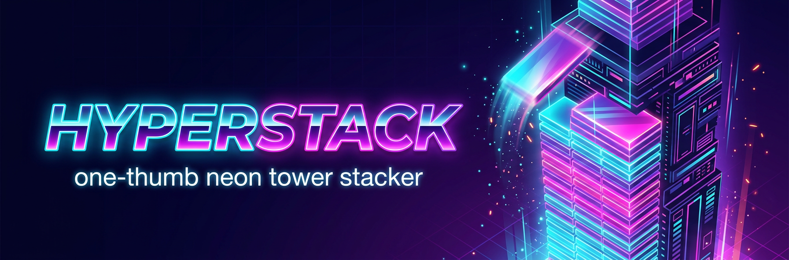

<div align="center">



**One-thumb neon tower stacker. Pure C++17 + raylib. Zero asset files.**

[](https://github.com/QUANTUMLOADER123/cghear/actions/workflows/android.yml)
[](https://github.com/QUANTUMLOADER123/cghear/actions/workflows/desktop.yml)

`C++17` · `raylib 5.5` · `OpenGL ES 2.0` · `Android arm64/armv7` · `Windows / Linux / macOS`

</div>

---

## The game

A slab slides over the tower — **tap to drop it**. Whatever hangs over the edge
is sliced off and falls with physics. Land **PERFECTLY** (≤ 9 units off) and the
slab snaps into place: a gold ring bursts out, a rising chime plays and your
combo grows. Chain **3+ perfects** and the tower starts *giving size back*.

- **One input.** Tap, click, spacebar — that's the whole control scheme.
- **Every run looks different.** Random hue palette per run, the whole world
  (sky, tower, glow) drifts through it as you climb.
- **Fully procedural audio.** Synthesized at boot with plain C math:
  sub-bass thud, noise swoosh for the slice, a 3-note perfect chime ladder,
  a game-over boom. No .wav/.ogg files anywhere.
- **Juice.** Screen shake, hit-stop zoom kick, falling debris with physics,
  parallax dust, grow-reward system, persistent best score.

## Mobile (APK)

CI builds an installable, debug-signed APK on every push to `main`
(**Actions → android-apk → hyperstack-apk**) and attaches it to GitHub
Releases on every `v*` tag. The APK is a pure-native `NativeActivity`
(`android:hasCode="false"`): no Java, no Gradle plugin — just `libmain.so`
for `arm64-v8a` + `armeabi-v7a`, GLES2 rendering and OpenSL ES audio.

Build it yourself:

```bash
export ANDROID_HOME=~/Android/Sdk
export ANDROID_NDK=~/Android/Sdk/ndk/27.0.11718014
bash android/build_apk.sh          # -> build-android/hyperstack.apk
adb install -r build-android/hyperstack.apk
```

The script hand-rolls the whole pipeline — `aapt2 → javac → d8 → ndk-build →
zipalign → apksigner` — so there is no Gradle, no wrapper and no Android
Studio involved.

## Desktop

```bash
cmake -B build -DCMAKE_BUILD_TYPE=Release
cmake --build build --parallel
./build/hyperstack
```

raylib 5.5 sources are downloaded automatically at configure time — no
submodules, no system package needed.

| Key | Action |
|---|---|
| Mouse / Space / Touch | drop the slab |
| that's it | seriously, that's it |

## Tests

`tests/run_headless.sh` compiles the game against a tiny pure-C++ raylib stub
(`tests/stub/raylib.h`) and simulates 12,000 frames: an autopilot must stack a
~100-floor perfect tower, random taps must crash it, and the retry loop must
kick in — all without a window or GPU. CI runs it on every platform.

## Layout

```
src/main.cpp            the whole game (~700 lines, C++17)
tests/stub/raylib.h     headless raylib stub for the logic test
tests/run_headless.sh   simulation test
android/                manifest, res, ndk-build files, APK pipeline script
.github/workflows/      android-apk + 3-platform desktop CI
docs/                   banner / screenshots
```

## License

MIT — see [LICENSE](LICENSE).
